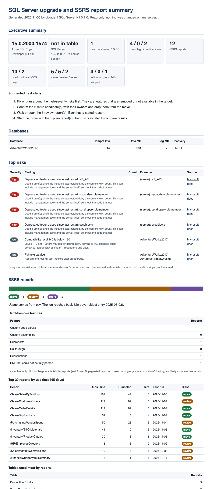

# db-agent CLI: a read-only DBA toolkit, one command group per database engine

```
db-agent <engine> <verb>
db-agent engines          # what is implemented and what is planned
```

| Engine | Status | Verbs |
|---|---|---|
| `sqlserver` | available | `inventory`, `ssrs`, `validate`, `report` |
| `databricks` | available; live-tested on one small AWS workspace only, see the docs | `health` ([docs](https://github.com/db-agent/db-agent-cli/blob/main/docs/databricks-health.md)) |
| `pg`| AWS Fleet Scan | `feel`  |

The rest of this page covers the `sqlserver` engine. How to add another: [docs/adding-an-engine.md](https://github.com/db-agent/db-agent-cli/blob/main/docs/adding-an-engine.md).

## db-agent sqlserver: inventory SQL Server and SSRS reports before you upgrade or move to Power BI

SQL Server 2016 reached end of support on July 14, 2026. SQL Server 2017 follows on October 12, 2027.
If you run SSRS (SQL Server Reporting Services) on either, you have two jobs: upgrade the database
server, and decide what happens to every report. This command line tool does the **SSRS migration
inventory** and the upgrade check, **read-only**. It lists your databases and reports, flags what will
break, sorts each report into **move**, **review** or **retire**, checks results after a move, and writes
a report you can hand to a manager or a client. It is the first step of an **SSRS to Power BI** move.

*Part of the [db-agent](https://github.com/db-agent) project.* Apache-2.0.



## What it does

| Command | What you get |
|---|---|
| `sqlserver inventory` | Version, edition, databases, tables, row counts (from metadata), views, procedures with code, linked servers, Agent jobs. **Upgrade risks**, each with a link to the Microsoft page it comes from. |
| `sqlserver ssrs` | Every report: data sources, datasets, tables and procedures used, parameters, subreports, custom code, subscriptions, usage. Each report is **move**, **review** or **retire** with the reason. |
| `sqlserver validate` | Runs each "move" report's queries on the old and new server and compares row counts and totals. |
| `sqlserver report` | One printable `summary.html` and one Excel workbook with all of it. |

## 5-minute demo (no database needed)

```bash
git clone https://github.com/db-agent/db-agent-cli && cd db-agent-cli
python3 -m venv .venv && .venv/bin/pip install -e .
make demo-files
```

This reads 12 sample reports and a synthetic usage log (`examples/`, clearly labelled sample data) and
opens `summary.html`. You will see 5 move, 5 review and 2 retire, each with a reason.

To also see `inventory` and `validate`, start two SQL Server containers, restore the AdventureWorks
sample database and run `make demo`. See [docs/demo.md](https://github.com/db-agent/db-agent-cli/blob/main/docs/demo.md).

## Install

Today: from source, as above (Python 3.11 or newer). PyPI, a Docker image and a Windows single-file
`.exe` are planned and **not built yet**.

Run it as `db-agent sqlserver <command>`. The old `db-agent-sqlserver <command>` still works.

```bash
db-agent sqlserver inventory --server sql01 --user dbagent_reader          # password: env DBAGENT_SQL_PASSWORD or a prompt
db-agent sqlserver ssrs --reportserver-db ReportServer --server sql01 --user dbagent_reader
db-agent sqlserver ssrs --rdl-folder ./reports --usage-csv executionlog.csv       # no server access needed
db-agent sqlserver validate --source "server=old,database=Sales,user=u" --target "server=new,database=Sales,user=u" --reports dbagent-sqlserver-output/reports.csv
db-agent sqlserver report
```

Output goes to `./dbagent-sqlserver-output` (change with `--out`). Windows authentication and Microsoft
Entra ID need `--driver odbc` and the Microsoft ODBC Driver 18 (`pip install ".[odbc]"`); that path is
**not tested yet**.

## What your DBA needs to grant

A dedicated login with read access to metadata and the ReportServer catalog. Nothing that can write.
The exact T-SQL script is in [docs/permissions.md](https://github.com/db-agent/db-agent-cli/blob/main/docs/permissions.md).

## Sample output

`reports.csv`, one row per report (a few of the columns):

| path | classification | runs_365 | last_run | reasons |
|---|---|---|---|---|
| /Inventory/BillOfMaterials | move | 41 | 2026-11-03 | Plain report, no hard-to-move features |
| /HR/EmployeeDirectory | review | 13 | 2026-11-02 | Custom code block (3 lines) |
| /Purchasing/VendorSpend | review | 50 | 2026-11-04 | Dataset SQL could not be fully parsed (Spend); table list is a guess |
| /Inventory/LegacyInventory | retire | 0 | | No runs in the last 365 days (log covers 520 days) |

## What it does not do

- It does **not convert reports.** It tells you what to move and what is hard. A layout hint says which reports look like Power BI paginated reports and which look like an interactive rebuild. It is a hint only.
- It does **not read business data** during `inventory` or `ssrs`. Row counts come from system views.
- `validate` is the one command that runs report queries. It keeps **only row counts and numeric totals**, never row values, and only on a login you choose to give read access to.
- It does **not change anything** on any server, and sends nothing over the network except to the SQL Servers you name.

## FAQ

**Is it safe?** Every statement goes through one guard that allows a single `SELECT` (or, with `--allow-exec`, a stored procedure you named). `SELECT ... INTO`, `OPENROWSET`, linked servers and anything it cannot parse are refused. Tests check that no command can bypass it. The login's permissions are the real boundary: give it only what [docs/permissions.md](https://github.com/db-agent/db-agent-cli/blob/main/docs/permissions.md) lists.

**What access does it need?** See above. For `ssrs` without database access, export the `.rdl` files and the execution log and run it on a laptop.

**Does it work with Azure SQL?** It reads Azure SQL Database and Managed Instance for `inventory` and flags what would not work there. Tested against one Azure SQL Database (AdventureWorksLT); Managed Instance is not tested.

**What about Power BI paginated reports?** Reports are classified by what is hard to move, not converted. The hint column says which look paginated. Check Microsoft's current paginated report limits for your reports.

**Why are no reports marked retire?** SSRS keeps its usage log for 60 days by default. A report that runs once a year looks unused in a 60-day log. The kit only calls a report retire when the log covers 365 days, and says so. See [docs/ssrs-inventory.md](https://github.com/db-agent/db-agent-cli/blob/main/docs/ssrs-inventory.md).

**Where does my data go?** Nowhere. Everything is written to a local folder. Object code (`modules.json`) can contain secrets: skip it with `--no-code`.

## Status

Version 0.1. Tested: 95 unit tests, and 8 integration tests that run against live SQL Server engines
(see [docs/testing.md](https://github.com/db-agent/db-agent-cli/blob/main/docs/testing.md) for exactly which engines, and what is not covered). `inventory` also ran against a real Azure SQL Database. Run on real SQL Server 2016, 2017 and 2022 engines and on a real SSRS 2016 server, including ODBC with Windows authentication. Not tested:
SSRS 2017 and later, domain (Kerberos) authentication, Entra ID, Azure SQL Managed Instance.

[Upgrade risk rules](https://github.com/db-agent/db-agent-cli/blob/main/docs/risk-rules.md) · [SSRS inventory](https://github.com/db-agent/db-agent-cli/blob/main/docs/ssrs-inventory.md) · [Permissions](https://github.com/db-agent/db-agent-cli/blob/main/docs/permissions.md) · [Examples](https://github.com/db-agent/db-agent-cli/blob/main/examples/README.md)

Need the upgrade and report move done for you at a fixed price? [becloudready.com/sql-server](https://becloudready.com/sql-server)
